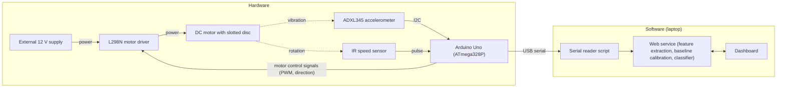

# Hardware

This document covers the physical rig, its wiring, the Arduino firmware and the hardware setup procedure. The software that runs on the laptop is documented in [SOFTWARE.md](SOFTWARE.md). The project overview is in [README.md](README.md).

---

## Table of Contents

- [Purpose of the Hardware](#purpose-of-the-hardware)
- [Components](#components)
- [Block Diagram](#block-diagram)
- [Power Architecture](#power-architecture)
- [Wiring](#wiring)
- [Arduino Pin Map](#arduino-pin-map)
- [Firmware](#firmware)
- [Serial Packet Format](#serial-packet-format)
- [Design Rationale](#design-rationale)
- [Setup Procedure](#setup-procedure)
- [Troubleshooting](#troubleshooting)
- [Hardware Limitations](#hardware-limitations)

---

## Purpose of the Hardware

The rig is a small rotating machine that can run in a normal state or with deliberate mass imbalance. It has two jobs:

1. **Control:** run a DC motor at a set speed through a motor driver.
2. **Sensing and acquisition:** measure the motor's vibration and shaft speed, sample the vibration at a fixed, evenly spaced rate, and send buffered windows to a laptop for feature extraction and classification.

Only the work that needs exact timing (sampling and buffering) runs on the microcontroller. Feature extraction, calibration, classification and display all run on the laptop.

---

## Components

| Component | Role | Interface |
|---|---|---|
| Arduino Uno (ATmega328P, 16 MHz, 2 KB SRAM) | Timed sampling, buffering, RPM counting, motor control, serial transmission | USB serial to laptop |
| ADXL345 3-axis accelerometer module | Vibration measurement; the firmware reads the X axis only | I2C, address `0x53` |
| IR slotted (optical) speed sensor module | One pulse each time a slot in the disc passes through the sensor gap | Digital output to external interrupt pin D2 |
| L298N dual H-bridge motor driver | Switches the 12 V supply to the motor based on PWM and direction signals | ENA (PWM), IN1, IN2 |
| DC motor (12 V) with slotted disc | Rotating machine under test; the disc is read by the IR sensor | Driven from L298N OUT1/OUT2 |
| External 12 V DC supply (12 V, 1 A) | Motor power, kept separate from the Arduino's supply | L298N 12V and GND terminals |
| Breadboard | Power rails and sensor connections | |
| Laptop | Powers the Arduino over USB and runs the software stack | USB |

The rig design includes a drill chuck on the motor shaft and an imbalance disc with adjustable screws. Mass imbalance is introduced by attaching a small weight to the rotor, shaft or disc.

---

## Block Diagram



Dashed arrows are physical couplings (vibration and rotation), not electrical connections. All grounds are common.

Data moves in two separate directions through the Arduino:

- **Sensing (inward):** the accelerometer sends acceleration readings over I2C, and the IR sensor sends speed pulses on D2.
- **Control (outward):** the Arduino sends a PWM speed signal and two direction signals to the L298N, which switches the 12 V supply to the motor.

---

## Power Architecture

Power comes from two separate sources that share a common ground:

| Path | Source | Feeds |
|---|---|---|
| Logic power | Laptop USB, through the Arduino | Arduino; 5V rail for the IR sensor; 3.3V rail for the ADXL345 |
| Motor power | External 12 V supply | L298N 12V terminal, and through it the motor |

The motor has its own supply because the Arduino cannot provide enough current to drive a motor. The motor's power wiring goes directly to the L298N and does not pass through the breadboard, so high-current wiring stays physically apart from the sensor connections.

**Common ground:** Arduino GND, both breadboard ground rails, the L298N GND terminal and the negative terminal of the 12 V supply are all connected. Without this shared reference, the PWM and direction signals cannot reliably control the driver.

---

## Wiring

The connections below match the pin assignments in `firmware/vibration_monitor.ino`.

### Power rails and common ground

| From | To |
|---|---|
| Arduino 5V | Breadboard top red rail |
| Arduino 3.3V | Breadboard bottom red rail |
| Arduino GND | Breadboard top blue rail and bottom blue rail (join the two blue rails with a jumper) |
| Arduino GND | L298N GND terminal |
| 12 V supply negative | L298N GND terminal (this connects all grounds together) |
| Laptop USB | Arduino USB port (powers the Arduino) |

### ADXL345 accelerometer (3.3 V, I2C)

| ADXL345 pin | Connection | Purpose |
|---|---|---|
| GND | Bottom blue rail (GND) | Ground |
| VCC | Bottom red rail (3.3 V) | Power |
| CS | Bottom red rail (3.3 V) | Pulled high to select I2C mode instead of SPI |
| SDO | Bottom blue rail (GND) | Pulled low to set the I2C address to `0x53` |
| SDA | Arduino A4 | I2C data |
| SCL | Arduino A5 | I2C clock |
| INT1, INT2 | Not connected | Interrupts are not used |

The accelerometer is mounted on the motor housing.

### IR speed sensor (5 V)

| Sensor pin | Connection | Purpose |
|---|---|---|
| VCC | Top red rail (5 V) | Power |
| GND | Top blue rail (GND) | Ground |
| OUT | Arduino D2 | Pulse output, read by an external interrupt |

The slotted disc on the motor shaft must pass through the sensor gap.

### L298N motor driver

| L298N terminal | Connection | Purpose |
|---|---|---|
| ENA jumper | **Removed** | Lets D10 control speed by PWM instead of running the motor at fixed full speed |
| ENA | Arduino D10 | PWM speed control |
| IN1 | Arduino D8 | Direction |
| IN2 | Arduino D9 | Direction |
| 12V | 12 V supply positive | Motor power input |
| GND | 12 V supply negative and Arduino GND | Common ground |
| OUT1, OUT2 | Motor wires (one each) | Motor output |

If the motor turns the wrong way, swap the two motor wires on OUT1 and OUT2. The second channel (IN3, IN4, ENB, OUT3, OUT4) is not used.

---

## Arduino Pin Map

| Arduino pin | Direction | Connected to | Function |
|---|---|---|---|
| D2 | Input (internal pull-up) | IR sensor OUT | External interrupt on the falling edge; counts speed pulses |
| D8 | Output | L298N IN1 | Direction (set HIGH) |
| D9 | Output | L298N IN2 | Direction (set LOW) |
| D10 | Output (PWM) | L298N ENA | Motor speed (duty 180 of 255) |
| A4 | I2C SDA | ADXL345 SDA | I2C data (Uno's fixed SDA pin) |
| A5 | I2C SCL | ADXL345 SCL | I2C clock (Uno's fixed SCL pin) |
| 5V | Power | Top red rail | IR sensor supply |
| 3.3V | Power | Bottom red rail | ADXL345 supply and CS pull-up |
| GND | Ground | Both blue rails, L298N GND | Common ground |
| USB | Serial | Laptop | Power and data at 115200 baud |

---

## Firmware

Source: `firmware/vibration_monitor.ino`. The firmware does not use external libraries beyond the built-in `Wire` (I2C) library.

### Configuration constants

| Constant | Value | Meaning |
|---|---|---|
| `SAMPLE_INTERVAL_US` | 1000 | Sampling period in microseconds (1000 Hz) |
| `WINDOW_SIZE` | 512 | Samples per window (0.512 s of signal) |
| `PULSES_PER_REV` | 1.0 | Slots on the speed disc; must match the physical disc |
| `G_PER_LSB` | 0.0039 | ADXL345 scale factor in full-resolution mode (3.9 mg/LSB) |
| `MOTOR_PWM_DUTY` | 180 | PWM duty cycle on ENA, out of 255 (about 71%) |
| Serial baud | 115200 | USB serial speed |
| I2C clock | 400 kHz | Fast mode, needed to read a sample every 1 ms |

`SAMPLE_INTERVAL_US` and `WINDOW_SIZE` must match `SAMPLE_RATE = 1000` and `WINDOW_SIZE = 512` in `serving/serial_reader.py`.

### ADXL345 configuration

| Register | Value written | Effect |
|---|---|---|
| `DATA_FORMAT` (0x31) | 0x08 | Full resolution, ±2 g range |
| `BW_RATE` (0x2C) | 0x0E | Output data rate 1600 Hz, which is above the 1000 Hz sampling rate |
| `POWER_CTL` (0x2D) | 0x08 | Measurement mode |

### Startup sequence (`setup()`)

1. Start serial at 115200 baud and I2C at 400 kHz.
2. **Sensor presence check:** read the ADXL345 device ID register (0x00). If it is not `0xE5`, the firmware prints `ADXL345 not found at 0x53 (DEVID read: 0x..). Check VCC/GND/CS/SDO wiring and SDA/SCL connections.` and stops in an infinite loop, so it never streams a meaningless signal. If the ID is correct, it prints `ADXL345 found at 0x53.`
3. Configure the ADXL345 registers listed above.
4. Set D2 as an input with pull-up and attach the `countPulse` interrupt on the falling edge.
5. Start the motor: IN1 HIGH, IN2 LOW, PWM duty 180 on ENA.

### Sampling loop (`loop()`)

- The loop checks `micros()` and takes a sample only when 1000 µs have passed since the last scheduled sample time. The next scheduled time is advanced by exactly 1000 µs (`lastSampleUs += SAMPLE_INTERVAL_US`) instead of being reset to the current time, so small delays do not build up into drift within a window.
- Each sample is a 2-byte read of the X-axis data registers (0x32, 0x33). If the I2C read returns fewer than 2 bytes, the previous sample value is repeated.
- Raw samples are stored as `int16_t` in a 512-element buffer, and a running sum is kept for the window mean.
- When the buffer is full, `sendWindow()` is called, the buffer and sum are reset, and the sampling clock is restarted with `micros()`. Transmission blocks sampling, so restarting the clock avoids a burst of catch-up samples at the start of the next window.

### RPM measurement

`countPulse()` is an interrupt service routine that increments a `volatile` pulse counter on each falling edge from the IR sensor, so pulses are counted without blocking the sampling loop. When a window is sent, the counter is read and reset with interrupts briefly disabled, and RPM is calculated as:

```
rpm = (pulses / PULSES_PER_REV / elapsed_seconds) * 60
```

`elapsed_seconds` is the time since the previous RPM calculation. It includes both the sampling period and the time spent transmitting the previous window.

### Window transmission

Before sending, the firmware subtracts the window mean from every sample. This removes the static gravity component, so the RMS feature reflects vibration only. Each sample is then converted to g (`(raw - mean) * 0.0039`) and printed with 4 decimal places.

### Memory budget

The Uno has 2 KB of SRAM. Samples are stored as raw 2-byte integers and converted to floating point only while they are being transmitted, so the 512-sample buffer uses 1024 bytes, about half the available SRAM. Startup messages use the `F()` macro to keep strings in flash memory.

---

## Serial Packet Format

Each window is sent as a single line of comma-separated text, terminated by a newline:

```
<rpm>,<sample_1>,<sample_2>,...,<sample_512>
```

- `rpm`: measured shaft speed, 2 decimal places.
- `sample_i`: mean-removed X-axis acceleration in g, 4 decimal places.

`serving/serial_reader.py` (documented in [SOFTWARE.md](SOFTWARE.md#data-sources-for-the-live-pipeline)) parses each line, skips lines that cannot be parsed as numbers (such as the startup message) and lines that do not contain exactly 512 samples, and forwards valid windows to the API's `/ingest` endpoint with `sample_rate = 1000`.

Each line is several kilobytes of text. At 115200 baud (about 11.5 KB/s), sending one window takes on the order of a few hundred milliseconds, during which sampling is paused. Consecutive windows are therefore separate 0.512 s snapshots, not a continuous recording.

---

## Design Rationale

The main hardware design decisions are as follows:

- **Arduino Uno instead of ESP32.** FFT-based features rely on evenly spaced samples, because timing jitter smears the frequency spectrum. The ESP32 runs background operating system tasks that can add unpredictable delays to a sampling loop. The Uno has no operating system, so a `micros()`-timed loop gives more predictable sample timing.
- **Split between microcontroller and host.** Only timing-critical sampling and buffering run on the Uno's 2 KB of SRAM. Everything that does not need real-time guarantees (FFT, feature extraction, calibration, classification, display) is moved to the laptop.
- **Separate motor supply with a common ground.** The Arduino cannot supply motor current, and the shared ground is needed for the control signals to work reliably.
- **Sensors on the breadboard, motor power off it.** This keeps high-current wiring away from the sensor connections.
- **ENA jumper removed.** This allows PWM speed control from D10.
- **Interrupt-driven speed counting.** Pulses on D2 are counted in an interrupt, so speed measurement does not interfere with the sampling loop.

Sample-interval jitter has not been measured, so the timing regularity of the loop in practice is not yet quantified.

---

## Setup Procedure

1. **Wire the circuit** as described in [Wiring](#wiring). Leave the external 12 V supply off.
2. **Connect the Arduino** to the laptop over USB.
3. **Open** `firmware/vibration_monitor.ino` in the Arduino IDE.
4. **Select the board and port:** Tools > Board > Arduino Uno, and Tools > Port > the Arduino's port (for example `COM3`).
5. **Upload** the sketch.
6. **Verify the sensor:** open the Serial Monitor at 115200 baud. It should print `ADXL345 found at 0x53.` followed by data lines. If it prints "not found", recheck the ADXL345 wiring before going further.
7. **Close the Serial Monitor.** It keeps the port open and blocks the Python serial bridge.
8. **Turn on the external 12 V supply.** The motor should start spinning.
9. **Start the software stack** (see [README.md](README.md#usage-hardware-mode) and [SOFTWARE.md](SOFTWARE.md#serving-api)): run `python app.py` in one terminal and `python serial_reader.py --port COM3` in another, both from `serving/`. The bridge should print `rpm=... prediction=None` roughly once per window.
10. **Calibrate:** open `http://127.0.0.1:5000`, click Start Calibration while the machine runs normally, wait for about 10 windows (roughly 10 to 15 seconds), then click Stop Calibration. The status changes to "Calibrated" and the verdict appears.
11. **Test a fault:** add a small weight to the rotor or disc and watch the verdict.

Recalibrate every time the sensor is moved or the mechanical setup changes. The `baseline.json` committed from the MaFaulDa demo is not valid for the rig.

---

## Troubleshooting

| Symptom | Likely cause and fix |
|---|---|
| Serial Monitor prints `ADXL345 not found at 0x53` | Check ADXL345 VCC (3.3 V), GND, CS (to 3.3 V), SDO (to GND), and SDA/SCL on A4/A5. The firmware stops after this message, so reset the board after fixing the wiring. |
| No output in the serial bridge terminal | The Serial Monitor is probably still open, or the wrong port was given to `--port`. |
| `rpm=0.0` on every window | Check that IR sensor OUT is on D2 and that the slotted disc passes through the sensor gap. |
| RPM value is a multiple of the expected speed | `PULSES_PER_REV` does not match the number of slots on the disc. |
| Motor does not spin | Check the common ground and the 12 V supply, and make sure the ENA jumper has been removed. |
| Motor spins in the wrong direction | Swap the motor wires on OUT1 and OUT2. |
| Bridge prints `skipping incomplete window` | A line was cut off or corrupted. Occasional skips are harmless; frequent skips suggest a loose USB connection or a baud rate mismatch. |
| Bridge prints `failed to reach http://...` | The Flask API is not running, or `--host` points to the wrong address. |

---

## Hardware Limitations

- **Single-axis sensing.** Only the ADXL345 X axis is read. The useful axis depends on how the module is mounted relative to the shaft, and the Y and Z axes are not used.
- **±2 g range.** Strong vibration above 2 g would clip.
- **Fixed motor operation.** Speed (PWM duty 180) and direction are hard-coded in the firmware. There is no way to change speed at runtime from the software, so tests at different speeds need a firmware change.
- **Gaps between windows.** Sampling stops while each window is transmitted, so windows are not continuous in time.
- **Possible aliasing.** The ADXL345 runs at a 1600 Hz output data rate (about 800 Hz bandwidth) while the Uno samples it at 1000 Hz. There is no filtering between the two, so sensor content between roughly 500 and 800 Hz can fold back into the 0 to 500 Hz band used for features.
- **Silent read failures.** A failed I2C read repeats the previous sample without reporting it.
- **RPM resolution.** With one slot per revolution and RPM measured once per window cycle, each window counts only a small number of pulses, so the reported RPM is coarse. RPM is shown on the dashboard but is not used as a classifier input.
- **No rig data in the repository.** The repository contains no recordings, measurements or classification results from the physical rig. All reported model results come from the MaFaulDa dataset (see [SOFTWARE.md](SOFTWARE.md#evaluation-results)).
