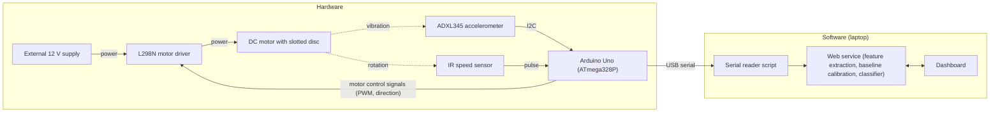

# Machine Vibration Monitoring

Predictive machine vibration monitoring using adaptive baseline calibration.

## Overview

This project is a vibration-based condition monitoring system for a small rotating machine. A DC motor is driven by an Arduino Uno through an L298N motor driver. An ADXL345 accelerometer measures vibration, and an IR slotted speed sensor measures shaft speed. The Arduino samples the accelerometer at a fixed 1 kHz rate, buffers 512-sample windows, and sends each window over USB serial to a laptop together with the measured RPM. On the laptop, a Python pipeline extracts four features from each window (RMS, dominant frequency, spectral energy and kurtosis), normalizes them against a per-machine baseline, and classifies the window as **normal** or **imbalance** using a small neural network. A browser dashboard shows the verdict, the classifier's imbalance probability, the waveform, the FFT spectrum and the feature values, refreshed every second.

### Core idea: adaptive baseline calibration

The classifier is trained once, offline, and its weights never change. The only thing that changes from one machine to another is the **baseline**: when the system is placed on a new machine (or the same machine after the sensor is moved), a short calibration window is recorded while the machine runs normally. The mean and standard deviation of each feature over that window become the baseline, and every later reading is turned into a z-score relative to it before reaching the classifier. Moving to a different machine means recording a new baseline, not retraining the model.

### System architecture



All grounds are common. Hardware details are in [HARDWARE.md](HARDWARE.md) and software details are in [SOFTWARE.md](SOFTWARE.md).

### Current results

The classifier was trained and evaluated on the normal and imbalance subsets of the MaFaulDa dataset (49 normal and 333 imbalance recordings, cut into 1910 one-second windows). Recordings are grouped into 51 "deployments" by rotation-frequency setpoint, and the train/test split is made by deployment, so the test set contains only setpoints the model never saw during training or calibration.

| Metric (13 held-out deployments, 449 windows) | Value |
|---|---|
| Overall accuracy | 95.8% |
| Normal: precision / recall / F1 (44 windows) | 0.857 / 0.682 / 0.759 |
| Imbalance: precision / recall / F1 (405 windows) | 0.966 / 0.988 / 0.977 |
| Macro-averaged F1 | 0.868 |

The test set is heavily imbalanced (405 imbalance windows vs 44 normal), so the overall accuracy mostly reflects the imbalance class. Recall on the normal class is lower (14 of 44 normal windows were classified as imbalance). These results come from the MaFaulDa dataset only. The repository does not include any recordings or results from the physical rig. See [SOFTWARE.md](SOFTWARE.md#evaluation-results) for details.

### Documentation

| Document | Contents |
|---|---|
| [HARDWARE.md](HARDWARE.md) | Components, power layout, complete wiring, pin map, firmware behaviour, serial packet format, setup procedure and troubleshooting |
| [SOFTWARE.md](SOFTWARE.md) | Dataset, feature extraction, calibration, classifier, training and evaluation, ablation study, Flask API, dashboard, demo tooling and deployment |

### Technology stack

| Layer | Technology |
|---|---|
| Microcontroller firmware | Arduino C++ (`Wire` library), Arduino Uno |
| Data processing and ML | Python, NumPy, SciPy, pandas, scikit-learn (`MLPClassifier`), joblib |
| Visualization (offline) | Matplotlib, Jupyter |
| Serving | Flask, gunicorn |
| Hardware bridge | pyserial, requests |
| Dashboard | HTML, vanilla JavaScript, Chart.js (CDN) |

---

## Project Structure

```
Machine-Vibration-Monitoring/
├── data/
│   ├── raw/                     # MaFaulDa dataset (not tracked, download separately)
│   └── processed/               # extracted features, cached demo windows
├── notebooks/
│   └── eda.ipynb                # exploratory data analysis
├── src/
│   ├── features.py              # RMS, dominant freq, spectral energy, kurtosis
│   ├── calibration.py           # adaptive baseline calibration
│   ├── dataset.py                # MaFaulDa dataset + synthetic dataset loaders
│   ├── model.py                   # classifier definition, save/load
│   ├── train.py                   # offline training script
│   └── ablation.py                # fixed-baseline vs adaptive-baseline comparison
├── results/
│   ├── eda/                     # EDA figures
│   ├── training/                 # metrics, confusion matrix
│   └── ablation/                  # ablation results
├── serving/
│   ├── app.py                    # Flask API
│   ├── build_demo_cache.py        # caches demo windows from MaFaulDa dataset
│   ├── simulate_stream.py          # replays cached windows into the API (no hardware needed)
│   ├── serial_reader.py             # reads Arduino serial, forwards to the API
│   └── model_store/                  # saved classifier + calibration baseline
├── dashboard/
│   ├── templates/
│   │   └── index.html
│   └── static/
│       └── dashboard.js
├── firmware/
│   └── vibration_monitor.ino    # Arduino Uno firmware
├── requirements.txt
├── Procfile                     # Render deployment
├── README.md                    # project overview, setup and usage
├── HARDWARE.md                  # rig components, wiring, firmware, setup procedure
└── SOFTWARE.md                  # dataset, features, calibration, model, API, dashboard
```

### Directory Contents

| Path | Contents |
|---|---|
| `data/processed/` | `mafaulda_features.csv`: the four features and class label for all 1910 MaFaulDa windows, generated by `notebooks/eda.ipynb`. `demo_windows.npz` is generated by `build_demo_cache.py` and excluded from version control. |
| `results/eda/` | `class_balance.png`, `waveform_comparison.png`, `fft_comparison.png`, `feature_distributions.png` |
| `results/training/` | `metrics.json`, `confusion_matrix.png` |
| `results/ablation/` | Reserved for ablation outputs. Not yet present; `ablation.py` currently prints its results to the console. |
| `serving/model_store/` | `classifier.joblib` (trained MLP) and `baseline.json` (baseline from a calibration run on MaFaulDa demo windows; replaced on the next calibration and not valid for the physical rig) |

## Setup
 
```
pip install -r requirements.txt

pip install flask requests pyserial gunicorn
```

`requirements.txt` includes `flask`, `requests`, `pyserial` and `gunicorn`; the second command installs the serving dependencies on their own. Package versions are not pinned.

The MaFaulDa dataset is required only for retraining the model and building the demo cache. It is downloaded separately and extracted so that `data/raw/normal/*.csv` and `data/raw/imbalance/<grams>g/*.csv` exist.
 
## Local Demo
 
No physical rig needed. This replays the real MaFaulDa windows into the API.

Steps 1 and 2 require the raw MaFaulDa dataset in `data/raw/`. A trained `classifier.joblib` is already included, so step 1 is optional unless retraining is intended.
 
1. Train the classifier (writes `serving/model_store/classifier.joblib`):
```
   cd src
   python train.py
```

2. Build the demo cache (one-time, ~10-20s):
```
   cd ../serving
   python build_demo_cache.py
```
 
3. Start the API (leave this terminal running):
```
    cd ../serving
   python app.py
```
 
4. In a **separate** terminal, stream the demo data:
```
   cd serving
   python simulate_stream.py
```
 
5. Open `http://127.0.0.1:5000` in a browser. It calibrates on real normal windows, then streams normal followed by imbalance windows -- watch the verdict flip from NORMAL to FAULTY live.

### Demo Sequence

`simulate_stream.py` sends 10 normal windows for calibration, followed by 10 unseen normal windows and 20 imbalance windows, at one window per second. The `--interval` option sets the delay between windows and `--host` sets the API address. Calibration overwrites `serving/model_store/baseline.json`.

The demo windows are drawn from the start of the dataset without excluding training deployments. The demo therefore verifies the end-to-end pipeline and is not an independent evaluation. Held-out evaluation results are reported in [SOFTWARE.md](SOFTWARE.md#evaluation-results).

## Usage (hardware mode)

The rig must be wired as specified in [HARDWARE.md](HARDWARE.md#wiring). The motor starts as soon as the firmware is running and the external 12 V supply is switched on.

1. Upload `firmware/vibration_monitor.ino` to the Arduino Uno with the Arduino IDE. The Serial Monitor (115200 baud) should print `ADXL345 found at 0x53.` Close the Serial Monitor afterwards so the port is free.
2. Start the API:
   ```
   cd serving
   python app.py
   ```
3. In a separate terminal, start the serial bridge (replace COM3 with the Arduino's port):
   ```
   cd serving
   python serial_reader.py --port COM3
   ```
4. Open `http://127.0.0.1:5000`. With the machine running normally, press Start Calibration, wait for about 10 windows, then press Stop Calibration. Live classification starts after calibration.

### Expected Output

Before calibration, the serial bridge prints `rpm=... prediction=None` for each window. After calibration, each line includes the prediction.

### Recalibration and Fault Testing

A new calibration is required whenever the sensor is moved or the mechanical setup changes. The included `baseline.json` was produced from MaFaulDa demo windows and does not apply to the rig. An imbalance fault is introduced by attaching a small weight to the rotor or disc.

### Serial Port Names

On Linux and macOS, the port name takes the form `/dev/ttyACM0` or `/dev/cu.usbmodemXXXX` instead of `COM3`. The `--host` option forwards windows to an API running on another machine.

The complete setup procedure and troubleshooting guide are in [HARDWARE.md](HARDWARE.md#setup-procedure).

## Known Limitations

The main limitations are summarized below. Complete lists are in [HARDWARE.md](HARDWARE.md#hardware-limitations) and [SOFTWARE.md](SOFTWARE.md#software-limitations).

- The classifier has only been evaluated on MaFaulDa data. MaFaulDa windows are 50,000 samples at 50 kHz from a different sensor and mounting point, while the rig sends 512 samples at 1 kHz from the ADXL345 X axis. Per-machine calibration is meant to absorb scale differences, but there is no recorded evidence yet of how the classifier performs on rig data.
- Normal-class recall on held-out deployments is 68%, and training does not use class weighting even though there are far more imbalance windows than normal ones.
- The adaptive-versus-fixed baseline comparison (`ablation.py`) runs only on synthetic signals, and its output is not saved in the repository.
- If a feature has zero variance during calibration (the committed `baseline.json` has zero standard deviation for dominant frequency), any later change in that feature gives an extremely large z-score, because the divisor is only `1e-8`.
- The Flask service keeps its state in memory for a single rig, has no authentication, and runs with `debug=True` when started directly.
- There are no automated tests.
