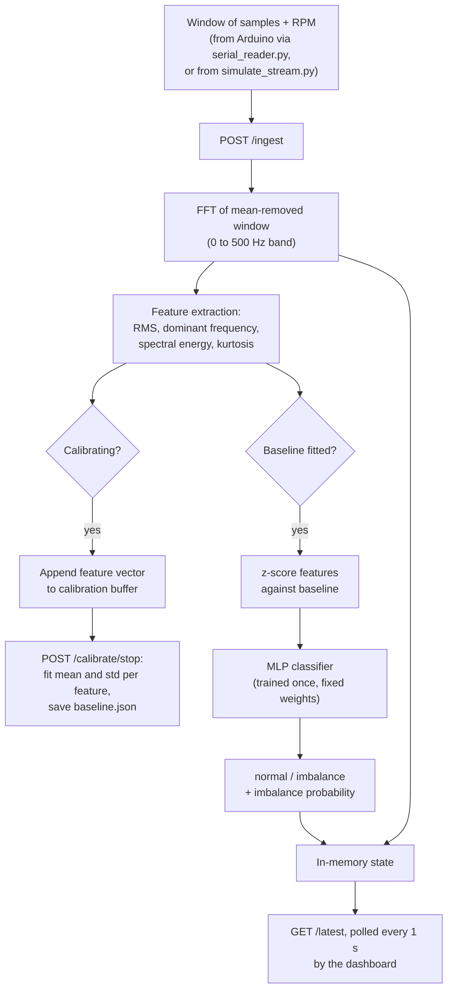

# Software

This document covers the software side of the project: the dataset, feature extraction, adaptive baseline calibration, the classifier, training and evaluation, the ablation study, the Flask service, the dashboard, and the demo and hardware bridge scripts. The physical rig and firmware are documented in [HARDWARE.md](HARDWARE.md). The project overview is in [README.md](README.md).

---

## Table of Contents

- [Pipeline Overview](#pipeline-overview)
- [Module Map](#module-map)
- [Dataset](#dataset)
- [Feature Extraction](#feature-extraction)
- [Adaptive Baseline Calibration](#adaptive-baseline-calibration)
- [Classifier](#classifier)
- [Training Procedure](#training-procedure)
- [Evaluation Results](#evaluation-results)
- [Exploratory Data Analysis](#exploratory-data-analysis)
- [Ablation Study](#ablation-study)
- [Serving API](#serving-api)
- [Dashboard](#dashboard)
- [Data Sources for the Live Pipeline](#data-sources-for-the-live-pipeline)
- [Deployment](#deployment)
- [Software Limitations](#software-limitations)

---

## Pipeline Overview



The same `features.py` and `calibration.py` code is used both for offline training (`train.py`, `ablation.py`) and for live inference (`serving/app.py`), so features are computed the same way during training and at run time.

---

## Module Map

| File | Responsibility |
|---|---|
| `src/features.py` | Computes the four features from one window and puts them in a fixed order |
| `src/calibration.py` | `BaselineCalibrator`: per-deployment mean and standard deviation, z-scoring, JSON save and load |
| `src/dataset.py` | MaFaulDa loaders (plain and grouped by deployment) and a synthetic signal generator |
| `src/model.py` | Builds, saves and loads the `MLPClassifier` |
| `src/train.py` | Offline training with per-deployment calibration and a deployment-level train/test split |
| `src/ablation.py` | Compares fixed and adaptive normalization on synthetic deployments |
| `notebooks/eda.ipynb` | Exploratory analysis of the MaFaulDa subset; writes figures and `mafaulda_features.csv` |
| `serving/app.py` | Flask API and dashboard host |
| `serving/serial_reader.py` | Reads windows from the Arduino over serial and posts them to the API |
| `serving/build_demo_cache.py` | Saves a small set of MaFaulDa windows for the demo |
| `serving/simulate_stream.py` | Replays the cached windows into the API to simulate the rig |
| `dashboard/templates/index.html`, `dashboard/static/dashboard.js` | Live dashboard |

---

## Dataset

### MaFaulDa (used for training and the demo)

The project uses the **normal** and **imbalance** subsets of the MaFaulDa (Machinery Fault Database) dataset, which has to be downloaded separately into `data/raw/`:

```
data/raw/normal/*.csv
data/raw/imbalance/<grams>g/*.csv      (6g, 10g, 15g, 20g, 25g, 30g, 35g)
```

Each CSV file is a 5-second recording at 50 kHz (250,000 rows) with 8 columns:

| Column | Signal |
|---|---|
| 0 | Tachometer |
| 1, 2, 3 | Underhang bearing accelerometer: axial, radial, tangential |
| 4, 5, 6 | Overhang bearing accelerometer: axial, radial, tangential |
| 7 | Microphone |

Only **column 2 (underhang bearing, radial)** is used, because it is the closest equivalent to a single-axis accelerometer mounted radially on a motor housing.

Subset size, as counted in `notebooks/eda.ipynb`:

| Class | Files | 1-second windows |
|---|---|---|
| Normal | 49 | 245 |
| Imbalance | 333 (6g: 49, 10g: 48, 15g: 48, 20g: 49, 25g: 47, 30g: 47, 35g: 45) | 1665 |
| **Total** | **382** | **1910** |

Each recording is cut into non-overlapping 1-second windows (50,000 samples, 5 per file). Labels are binary: normal = 0, imbalance = 1.

### Deployment grouping

`load_mafaulda_by_deployment()` also returns a deployment identifier for each window. MaFaulDa file names encode the rotation frequency in Hz (for example `12.288.csv`), and the same set of frequencies appears in both the normal and imbalance folders. The frequency is rounded to the nearest whole Hz, and each rounded value is treated as one **deployment**, standing in for one machine. If a file name cannot be read as a number, its full path is used as the identifier. The training data contains 51 deployments.

### Synthetic generator (used by the ablation study)

`generate_synthetic_dataset()` creates vibration-like signals at 4 kHz: a sine wave at a base frequency, plus its second harmonic at 30% amplitude, plus Gaussian noise. Each synthetic deployment draws its own gain (0.5 to 2.6), base frequency (40 to 60 Hz) and noise floor (0.03 to 0.18) from a random generator seeded by the deployment parameters. Normal windows use 0.4 times the deployment gain; imbalance windows use 1.1 times the gain and 2.2 times the noise. Deployment characteristics are drawn independently at random, not along a smooth trend, so a single global scaler cannot simply extrapolate to unseen deployments.

---

## Feature Extraction

`src/features.py` computes four features from each window, always in this order: `["rms", "dominant_freq", "spectral_energy", "kurtosis"]`.

| Feature | Computation | Physical meaning |
|---|---|---|
| RMS | `sqrt(mean(x^2))` on the window as received | Overall vibration strength |
| Dominant frequency | Frequency of the largest FFT magnitude between 0 and 500 Hz | Frequency where the vibration is strongest; related to shaft speed |
| Spectral energy | Sum of squared FFT magnitudes between 0 and 500 Hz | Total vibration energy in the band of interest |
| Kurtosis | Fisher (excess) kurtosis, bias-corrected (`scipy.stats.kurtosis(fisher=True, bias=False)`) | Shape of the amplitude distribution: occasional sharp spikes give high values, smooth periodic motion gives low values |

Implementation details:

- The FFT is a real FFT (`scipy.fft.rfft`) of the window with its mean removed. No tapering window (such as Hann) is applied before the FFT.
- The frequency-domain features only use frequencies up to `DEFAULT_MAX_FREQ = 500 Hz`. Rotor speeds in this project fall in the 12 to 61 Hz range, and imbalance appears at that frequency and its low harmonics. Higher-frequency content is unrelated to imbalance and could otherwise dominate the spectrum.
- RMS is computed on the window as received. MaFaulDa windows are not mean-removed before RMS. Rig windows are already mean-removed by the firmware.
- Spectral energy is an unnormalized sum, so its scale depends on window length and sample rate as well as signal amplitude.

In the MaFaulDa subset, imbalance windows have **lower** median kurtosis than normal windows (-0.71 vs -0.18 in `mafaulda_features.csv`), consistent with imbalance producing a smooth periodic signal rather than impulsive spikes.

---

## Adaptive Baseline Calibration

`src/calibration.py` defines `BaselineCalibrator`, which is the core of the project.

**Concept.** The classifier is trained once on baseline-relative features and is never retrained. What changes for each machine is only the baseline. On a new deployment, a calibration window is recorded while the machine is assumed to be running normally. The calibrator stores the mean and standard deviation of each feature over that window, and every later feature vector is expressed relative to it:

```
z = (features - baseline_mean) / (baseline_std + eps),     eps = 1e-8
```

Switching to a different motor, or reassembling the same one, means calling `fit()` again on a new calibration window. The classifier's weights do not change.

**Interface.**

| Method | Purpose |
|---|---|
| `fit(calibration_features)` | Computes per-feature mean and standard deviation from an `(n_windows, 4)` array |
| `transform(feature_vectors)` | Returns z-scores; raises an error if the calibrator has not been fitted |
| `fit_transform(...)` | Fits and transforms the same data |
| `is_fitted` | True once a baseline exists |
| `save(path)` / `load(path)` | Stores and loads the baseline as JSON (`mean`, `std`, `eps`) |

**Calibration length.** The system design specifies a 30 to 60 second calibration window. The live service accepts any calibration of at least 3 windows, the hardware setup procedure ([HARDWARE.md](HARDWARE.md#setup-procedure)) uses about 10 windows, and training uses 3 windows per deployment (out of 5 normal windows available per setpoint in MaFaulDa).

**Committed baseline.** `serving/model_store/baseline.json` was saved from a demo calibration on MaFaulDa windows:

| Feature | Mean | Std |
|---|---|---|
| RMS | 0.3084 | 0.0015 |
| Dominant frequency | 117.0 Hz | 0.0 |
| Spectral energy | 7.93e6 | 1.87e5 |
| Kurtosis | -0.694 | 0.048 |

The standard deviation for dominant frequency is zero, so the divisor for that feature is only `1e-8`. Any later window whose dominant frequency differs from 117 Hz, even by one FFT bin, gets a z-score in the order of 10^8 or more for that feature. This baseline only applies to the MaFaulDa demo and is replaced the next time calibration is run.

---

## Classifier

Defined in `src/model.py`:

| Property | Value |
|---|---|
| Model | `sklearn.neural_network.MLPClassifier` |
| Architecture | 4 inputs, hidden layers of 16 and 8 units, 1 output (binary) |
| Activation | ReLU |
| Optimizer | scikit-learn default (Adam) |
| Max iterations | 2000 |
| Random state | 42 |
| Class weighting | None |
| Persistence | joblib (`serving/model_store/classifier.joblib`, about 20 KB) |

A scikit-learn MLP was chosen because it is small to serialize, has no native binary dependencies for hosting, and trains quickly on 4-dimensional inputs. No other part of the pipeline depends on the model library, so a Keras model can replace it without further changes.

---

## Training Procedure

Run from `src/`:

```
cd src
python train.py
```

Steps in `train.py`:

1. Load all MaFaulDa windows with their deployment identifiers (1-second windows, column 2).
2. **Split by deployment, not by window.** `train_test_split` on the unique deployment identifiers with `test_size=0.25` and `random_state=42` gives 38 training and 13 held-out deployments. No window from a held-out setpoint is used for training or for fitting any baseline used in training.
3. **Calibrate each deployment separately.** For every deployment in a split:
   - Extract features from all of its windows.
   - Reserve its first 3 normal windows as the calibration set and fit a `BaselineCalibrator` on them.
   - Exclude those 3 calibration windows from the data, so normal windows are never scored against a baseline computed from themselves.
   - z-score the remaining windows (normal and imbalance) against that deployment's baseline.
   - Deployments with 3 or fewer normal windows are skipped and reported.
4. Pool the calibrated windows of the training deployments and fit the MLP.
5. Evaluate on the pooled held-out deployments.
6. Write `results/training/metrics.json`, `results/training/confusion_matrix.png` and `serving/model_store/classifier.joblib`.

All paths in `train.py` are relative (`../data/raw`, `../serving/model_store/...`), so the script must be run from inside `src/`.

---

## Evaluation Results

From `results/training/metrics.json` and `results/training/confusion_matrix.png`:

| Split | Deployments | Windows | Accuracy |
|---|---|---|---|
| Train | 38 | 994 | 96.6% |
| Held-out | 13 | 449 | 95.8% |

Held-out classification report:

| Class | Precision | Recall | F1 | Support |
|---|---|---|---|---|
| Normal | 0.857 | 0.682 | 0.759 | 44 |
| Imbalance | 0.966 | 0.988 | 0.977 | 405 |
| Macro average | 0.912 | 0.835 | 0.868 | 449 |
| Weighted average | 0.955 | 0.958 | 0.956 | 449 |

Held-out confusion matrix (rows are true labels, columns are predictions):

| | Predicted normal | Predicted imbalance |
|---|---|---|
| **True normal** | 30 | 14 |
| **True imbalance** | 5 | 400 |

Observations:

- The held-out set is about 90% imbalance windows, so overall accuracy is dominated by the imbalance class. A classifier that always predicted "imbalance" would score about 90.2% accuracy on this set. Macro F1 (0.868) and normal-class recall (0.682) show performance across both classes more clearly.
- 14 of 44 normal held-out windows (about 32%) were classified as imbalance. In a monitoring setting this would show up as false alarms.
- Each deployment's baseline is computed from only 3 one-second windows, much shorter than the 30 to 60 second calibration window specified for live use. A short, noisier baseline is a possible cause of the lower normal-class recall; this has not been tested experimentally.
- The results are from a single deployment split (one random seed). No cross-validation or repeated splits are reported.
- All results come from MaFaulDa. None come from the physical rig.

---

## Exploratory Data Analysis

`notebooks/eda.ipynb` (run from `notebooks/`, needs `data/raw/`) produces:

| Output | Content |
|---|---|
| `results/eda/class_balance.png` | Number of normal vs imbalance recordings |
| `results/eda/waveform_comparison.png` | First second of a normal recording and a 20 g imbalance recording (radial channel) |
| `results/eda/fft_comparison.png` | FFT of the same two windows, 0 to 500 Hz |
| `results/eda/feature_distributions.png` | Box plots of the four features by class over all 1910 windows |
| `data/processed/mafaulda_features.csv` | The four features and class label for every window |

The notebook points out that the class imbalance at window level (245 normal vs 1665 imbalance) should be handled in training with a stratified split, class weights or both. The current `train.py` splits by deployment and does not use class weights.

---

## Ablation Study

`src/ablation.py` tests whether per-deployment calibration generalizes to unseen machines better than a single fixed normalization.

Both arms use standardized features and the same MLP architecture. The only difference is **when the scale is computed**:

| Arm | Normalization |
|---|---|
| Fixed (`clf_fixed`) | One `StandardScaler` fitted once on all training deployments pooled together, then frozen |
| Adaptive (`clf_adaptive`) | `BaselineCalibrator` fitted separately on each deployment's first 15 normal windows |

Setup:

- Synthetic data only, 4 kHz sample rate, 40 windows per class per deployment.
- Training deployments: shift values -8, -4, 0, 4, 8. Held-out deployments: -12, 12, 20. The shift values only seed the random draw of each deployment's characteristics; they are not physical quantities.
- For each held-out deployment, the script reports accuracy and ROC AUC for both arms, and then the mean accuracy.

Run with:

```
cd src
python ablation.py
```

The script prints its results to the console and does not save them. `results/ablation/` (listed in the project structure in [README.md](README.md#project-structure)) does not exist yet, so no ablation figures are reported here. A version of this comparison on real MaFaulDa deployments has not been implemented.

---

## Serving API

`serving/app.py` is a Flask application. It loads `classifier.joblib` and `baseline.json` at startup if they exist, serves the dashboard, and keeps all runtime state in one in-memory dictionary, because it serves one physical rig at a time.

### Endpoints

| Method | Path | Request body | Response |
|---|---|---|---|
| GET | `/` | | Dashboard page |
| GET | `/health` | | `{"status": "ok", "model_loaded": true/false}` |
| POST | `/ingest` | `window` (list of samples, required), `sample_rate` (Hz, defaults to 4000), `rpm` (optional) | `prediction` (`"normal"`, `"imbalance"` or `null`), `probability` (imbalance probability or `null`), `features` |
| POST | `/calibrate/start` | | Starts collecting incoming feature vectors into a fresh calibration buffer |
| POST | `/calibrate/stop` | | Fits a new baseline on the buffer and saves it to `baseline.json`; returns `n_windows`. Returns `400` if fewer than 3 windows were collected. |
| GET | `/latest` | | Full current state (see below) |

`/ingest` returns `400` if `window` is missing. A prediction is produced only when both a model and a fitted baseline are available. While calibration is running, windows are still classified against the previous baseline if one exists.

### State returned by `/latest`

| Field | Content |
|---|---|
| `latest_window` | Last 500 samples of the most recent window |
| `latest_fft` | `freqs` and `magnitude` arrays for 0 to 500 Hz |
| `sample_rate`, `rpm` | As received in the last `/ingest` call |
| `features` | The four feature values (before calibration) |
| `prediction`, `probability` | Latest classification |
| `calibrated`, `calibrating` | Calibration status flags |
| `calibration_buffer` | Feature vectors collected so far in the current calibration |
| `last_update` | Unix timestamp of the last `/ingest` call |

### Running

```
cd serving
python app.py              # development server on 0.0.0.0, port from $PORT or 5000, debug=True
```

---

## Dashboard

`dashboard/templates/index.html` and `dashboard/static/dashboard.js` form a single page that calls `GET /latest` once per second.

| Element | Content |
|---|---|
| Calibration status | "Not calibrated", "Calibrating..." or "Calibrated", with Start and Stop Calibration buttons |
| Verdict | "NORMAL" (green) or "FAULTY -- imbalance" (red), or "--" with "waiting for calibration" |
| Confidence | The classifier's imbalance probability as a percentage |
| Waveform chart | Last 500 samples of the latest window |
| FFT chart | FFT magnitude from 0 to 500 Hz |
| Feature table | RMS, dominant frequency (Hz), spectral energy, kurtosis and RPM |

Display behaviour:

- The "confidence" figure is always the probability of **imbalance**, including when the verdict is NORMAL. A NORMAL verdict therefore comes with a low percentage, for example 2%.
- For hardware windows (512 samples) the waveform shows almost the whole window. For MaFaulDa demo windows (50,000 samples at 50 kHz) it shows only the last 10 ms.
- Chart.js is loaded from a CDN without a pinned version, so the dashboard needs internet access and may be affected by Chart.js updates.
- When calibration is stopped, the result is shown in a browser `alert()`. The enabled or disabled state of the calibration buttons is not restored after a page reload.

---

## Data Sources for the Live Pipeline

The API accepts windows from two interchangeable sources.

### Hardware: `serving/serial_reader.py`

```
cd serving
python serial_reader.py --port COM3 [--baud 115200] [--host http://127.0.0.1:5000]
```

- Opens the serial port, waits 2 seconds (the Uno resets when the port is opened) and clears the input buffer.
- Reads one line per window in the format `<rpm>,<s1>,...,<s512>` (see [HARDWARE.md](HARDWARE.md#serial-packet-format)).
- Skips lines that are not numeric or do not contain exactly 512 samples.
- Posts `{window, sample_rate: 1000, rpm}` to `/ingest` and prints the RPM and prediction.

`SAMPLE_RATE = 1000` and `WINDOW_SIZE = 512` must match the firmware constants.

### Simulation: `serving/build_demo_cache.py` and `serving/simulate_stream.py`

`build_demo_cache.py` (run once, needs `data/raw/`) loads the full MaFaulDa subset and saves `data/processed/demo_windows.npz` with:

- `calibration_windows`: the first 10 normal windows
- `normal_eval_windows`: the next 10 normal windows
- `imbalance_eval_windows`: the first 20 imbalance windows
- `sample_rate`: 50000

Windows are taken in file-listing order (`glob`, unsorted), so the exact files chosen can depend on the file system, and with 5 windows per file the calibration windows come from only two recordings. Deployments used in training are not excluded.

`simulate_stream.py` then:

1. Calls `/calibrate/start`, sends the 10 calibration windows, and calls `/calibrate/stop`.
2. Sends the 10 normal evaluation windows followed by the 20 imbalance windows, printing each prediction.

```
cd serving
python simulate_stream.py [--host http://127.0.0.1:5000] [--interval 1.0]
```

The demo shows the pipeline working end to end on real accelerometer data, with the verdict expected to change from NORMAL to FAULTY when imbalance windows begin. Because the demo windows may overlap with training deployments, the demo is not an independent evaluation.

---

## Deployment

The `Procfile` defines a web process for platforms such as Render:

```
web: gunicorn --chdir serving app:app
```

Deployment considerations:

- All runtime state is held in process memory. With more than one gunicorn worker, each worker would have its own state and calibration. The `Procfile` uses gunicorn's default of one worker.
- `calibrate/stop` writes `baseline.json` to local disk. On hosts with ephemeral file systems, a saved baseline is lost when the service restarts.
- The serial bridge always runs on the machine that the Arduino is plugged into. It can send data to a hosted API with `--host`.
- No endpoint requires authentication, so anyone who can reach a hosted instance can send data, start or stop calibration, and read the state.

---

## Software Limitations

**Validity of the model on the rig**
- The classifier was trained on MaFaulDa windows (50,000 samples at 50 kHz, underhang radial channel), but the rig sends 512-sample windows at 1 kHz from the ADXL345 X axis. Window length, frequency resolution (1 Hz vs about 1.95 Hz per bin), sensor type, units and mounting all differ. Per-deployment z-scoring is meant to absorb differences in scale, but how the trained classifier performs on rig data has not been measured, and no rig data is included in the repository.
- Dominant frequency is limited to the FFT bins of the window, so with few calibration windows its standard deviation can be zero. Because the divisor is then only `eps = 1e-8`, small changes in dominant frequency give extremely large z-scores (this is the case in the committed `baseline.json`).

**Evaluation**
- Normal-class recall on held-out deployments is 0.682, and the held-out set is about 90% imbalance windows.
- No class weighting or resampling is used despite the class imbalance.
- Results come from a single random deployment split with no cross-validation.
- Only one fault type (imbalance) is modelled, as a binary normal-vs-imbalance problem.
- The ablation study runs only on synthetic data, and its results are not saved.

**Signal processing**
- No tapering window is applied before the FFT, so spectral leakage is not reduced.
- Spectral energy is not normalized for window length or sample rate.
- RPM is passed through to the dashboard but is not used as a feature.

**Service and tooling**
- In-memory, single-rig state; no authentication; `debug=True` when run with `python app.py`.
- `/ingest` falls back to a 4000 Hz sample rate if `sample_rate` is missing, which does not match either real data source.
- `src/` modules are imported through `sys.path` changes instead of being installed as a package, and the training scripts rely on being run from specific directories.
- Dependency versions are not pinned in `requirements.txt`, and Chart.js is loaded from a CDN without a pinned version.
- There are no automated tests.
